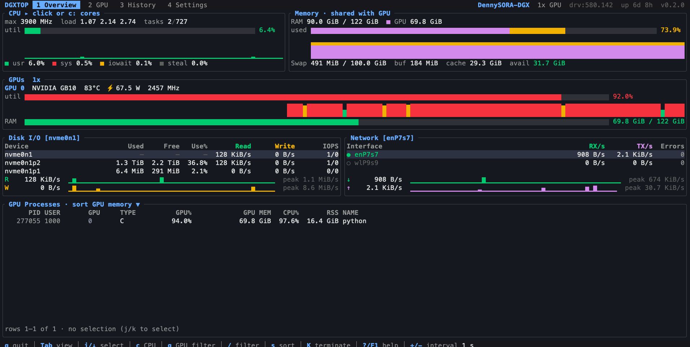
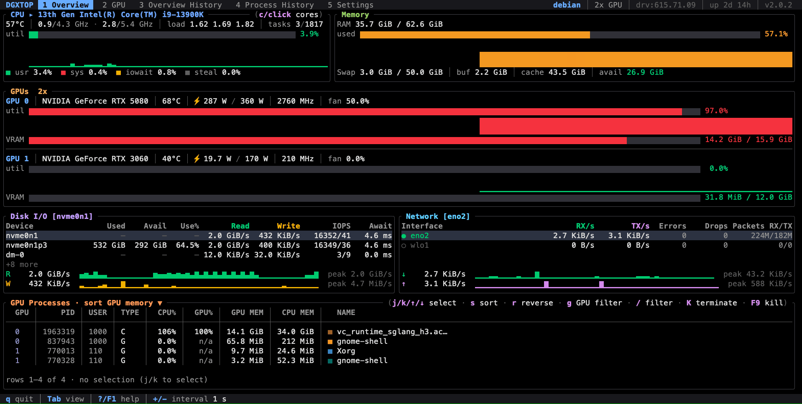
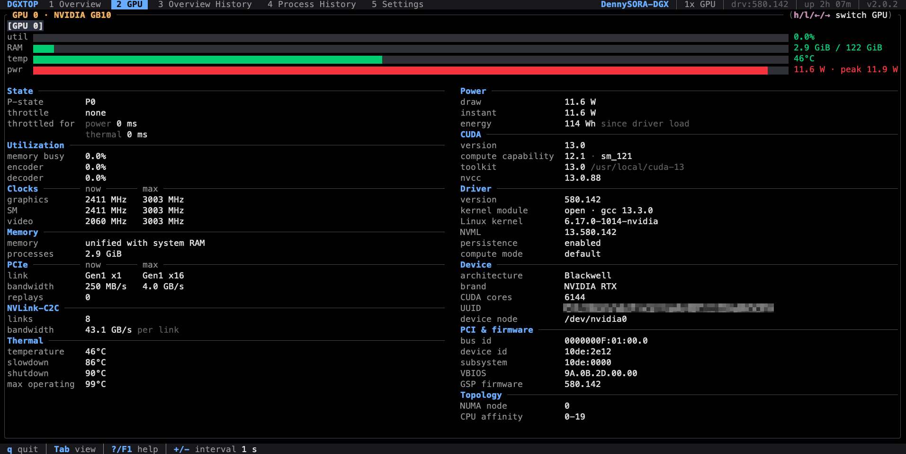
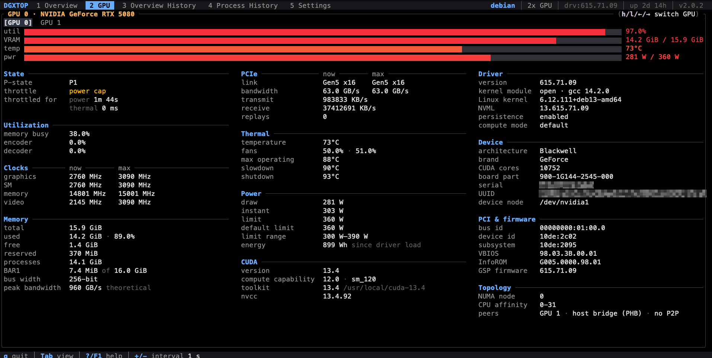
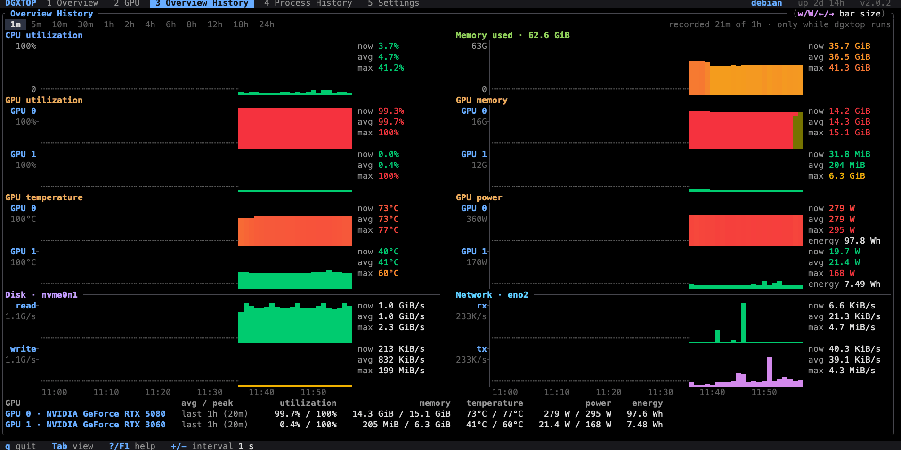
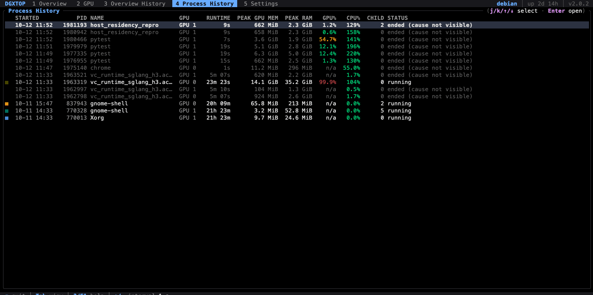
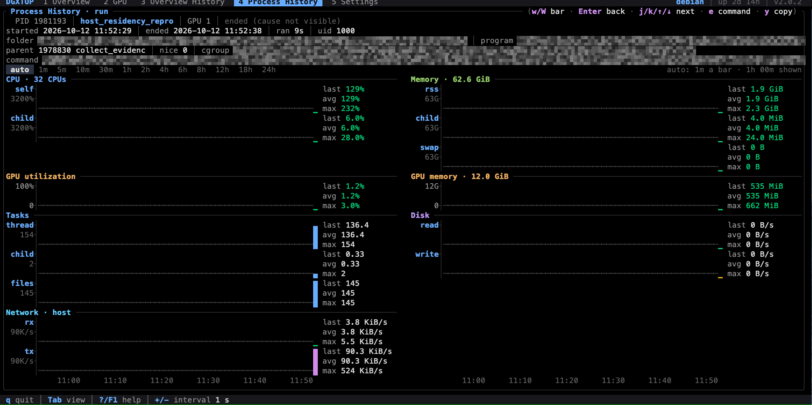
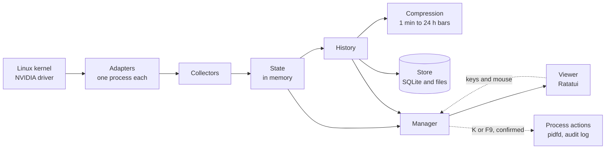

<div align="center">

# dgxtop

**A terminal monitor for NVIDIA GPUs on Linux and DGX Spark**

Every GPU, each job's share of its memory and the whole machine on one screen,<br>
plus a record of every GPU job from start to end, including how it ended.

[繁體中文](docs/README.zh-TW.md) · [日本語](docs/README.ja.md) · [Project page](https://dennysora.me/en/projects/tools/dgxtop/) · [How it works](https://dennysora.me/en/projects/tools/dgxtop/#architecture)

[](https://github.com/DennySORA/dgxtop/releases/latest)
[](LICENSE)
[](rust-toolchain.toml)
[](https://github.com/DennySORA/dgxtop/actions/workflows/ci.yml)



<sub>Overview on a DGX Spark. The GB10 shares memory with the CPU, so the RAM bar shows the system's share and each GPU process's share in its own color.</sub>

</div>

## Install

```bash
curl -fsSL https://raw.githubusercontent.com/DennySORA/dgxtop/main/install.sh | bash
```

Linux on x86_64 or aarch64 with glibc 2.34 or newer (Ubuntu 22.04, Debian 12, RHEL 9 and later),
DGX Spark included. WSL 2 runs the Linux build. GPU metrics need the NVIDIA driver; without it, CPU,
memory, disks and network still work. WSL 1, musl, macOS and Windows are not supported.

The installer picks the build for your CPU, checks it against the release's `SHA256SUMS` and
installs it to `~/.local/bin`. The previous version is kept, and `./install.sh --rollback` brings
it back. For a specific release, append `-s -- --version v2.4.0` to `bash`.

Or build from source with Rust 1.92.0 (pinned by `rust-toolchain.toml`):

```bash
git clone https://github.com/DennySORA/dgxtop.git
cd dgxtop
cargo build --release --locked
./target/release/dgxtop
```

## Features

htop centers on the CPU, and nvtop and nvidia-smi show GPUs only while you watch. dgxtop puts the
GPUs first, shows which job holds how much of their memory, and keeps a record of every GPU job and
of the whole machine.

- **Every GPU at a glance.** Utilization, memory, temperature, power, clocks and fans for each GPU,
  with live charts. Gauges, chart columns and temperatures shade in 100 steps from green at 0 %
  through amber at 50 % to red at 100 % (a temperature on a 0–100 °C scale).
- **Memory by process.** The eight processes holding the most GPU memory each get a color, the same
  in the memory bars, the charts and the process table, so you see which job holds how much. The
  color comes from the process name, so a job keeps it when the job or dgxtop restarts, unless another listed process already has it.
- **Named by what they run.** `python -m vllm.entrypoints.openai.api_server` shows as
  `vllm.api_server`, and `python main.py` in a `ComfyUI` folder as `ComfyUI/main`, not as
  `python3`.
- **GPU processes.** Every process using a GPU, with its GPU, type (compute or graphics), GPU use,
  GPU memory, CPU and RAM. Sort by any column, filter by GPU or name, and stop a process with `K`
  (SIGTERM) or `F9` (SIGKILL) after a confirmation. `F9` then `y` typed at once still counts, and a
  stopped process leaves the list as soon as it exits.
- **Process History.** Every GPU process is recorded as a run, from start to end: its runtime, peak
  GPU memory and RAM, GPU and CPU use, and how it ended: exited with a code, killed by a signal,
  stopped from dgxtop, most likely the OOM killer, or still running. Open a run for its full
  command line, working folder and charts of its CPU, memory, GPU, threads, open files, disk and
  network. Delete the runs you no longer need, marked one by one or all at once.
- **Overview History.** CPU, memory, each GPU's utilization, memory, temperature and power, disks
  and network as bars of 1 minute to 24 hours on the local clock, with now, average and maximum on
  every chart and the energy on the power charts. With several GPUs the GPU charts show one GPU at
  a time. Where the CPU's power can be read, the power charts start with the total of the CPU and
  the GPUs and the CPU's own, each with its energy.
- **Full GPU details.** One GPU at a time:
  - performance state, throttle reasons and how long it was throttled, clocks;
  - memory and the memory bus, PCIe link and traffic, NVLink-C2C;
  - thermal limits, fans, power limits and energy;
  - CUDA, driver, NVML and Linux kernel versions;
  - device, PCI and firmware, NUMA and CPU affinity, P2P paths.

  A value the GPU does not report gets no row.
- **The whole machine.** CPU usage per core, CPU temperature and power and the current and maximum
  frequency of each kind of core; memory, swap, buffers and cache; disks with free space, IOPS,
  latency and drive temperature; network throughput, errors and drops. Where the CPU's power can be
  read (powercap, or the GB10's power sensors), the header shows what the CPU and the GPUs draw
  together; that is not the power at the wall socket, and it is left out while a part cannot be
  read.
- **Made for DGX Spark.** On the GB10's unified memory, the RAM bar splits into the system's share
  and each GPU job's share. dgxtop also reads the GB10's CPU cluster temperatures and its
  NVLink-C2C links, and ships a native aarch64 build.
- **Settings in the app.** Change the sampling interval and the display modules, and see each data
  source's state. Every setting shows its saved and effective value, where it came from, and
  whether it applies now or after a restart.

## Screens

### Overview

Every GPU with its utilization and memory, the CPU, memory, busiest disks and network interfaces,
and the GPU processes in their colors. `c` expands the CPU into per-core bars and sensors. `i` / `n`
fold the disk I/O and network panels to one row so the processes get the rest, and `o` unfolds them
(a click on a folded row does too); each foldable panel names its key on its title, and folded
panels stay folded after a restart. `z` shows the GPU processes alone on the whole Overview for a
moment, to look through them and act on them; `z` again, `Esc` or another view brings the rest back.



### GPU

One GPU at a time: four live bars that stay put, then everything the driver reports. A GPU that
reports no power limit, such as the GB10, draws its power bar against the highest draw the history
kept on disk recorded in the last 30 days, and shows the draw alone until that record reaches
before today. `←` / `→`
(`h` / `l`) switch between GPUs; sections that do not fit go on pages under a line that names the
page and its keys, and `↑` / `↓` turn them.





<sub>GB10 with unified memory and NVLink-C2C (top); RTX 5080 with VRAM and PCIe Gen5 (bottom). Serial numbers and UUIDs are masked.</sub>

### Overview History

The machine's resources as bars of 1 minute to 24 hours (`←` / `→`, or `w` / `W`), with now,
average and maximum on every chart. With several GPUs, `↑` / `↓` pick the GPU the GPU charts show;
when the charts do not all fit, a line under the bar sizes says how many are above and below, and
`PgUp` / `PgDn` scroll them. To give the charts you watch more room,
fold the others to their title row, first on the page, with the key each panel names on its title: `c` CPU, `m` memory, `u` GPU
utilization, `v` GPU memory, `t` temperature, `p` power, `i` disk, `n` network; `o` unfolds them all,
and folds stay after a restart.



### Process History

Every GPU process as a run, the running ones always on top, then the newest first: when it started,
how long it ran, its peak GPU memory and RAM, and how it ended. `Enter` opens a run: its details
stay put at the top (when it started and ended, how long it ran, its parent, working folder,
program, control group and command line, which `e` shows whole and `y` copies) above its charts;
the GPU panel, titled with each GPU's model (`GPU 0 · RTX 5080`), shows each GPU the run used: its
utilization there (`util 0`, or the GPU's own, `dev 0`,
where the driver gives none per process, as on the GB10) and its memory there (`mem 0`); past four
GPUs, the rest are in the sums (`util Σ`, `mem Σ`). `dev` is every process on that GPU together, so
while two jobs share it, both runs show their sum; the list's start and run times tell which ran at
once. When the
charts do not fit at a legible height they go on pages under a line that names the page, and
`↑` / `↓` turn them. `/` filters the runs by name or PID. `g` / `G` go to the top / the end of
the list. `Space` marks a run, `a` marks every ended run, and `d` deletes the marked runs, or the selected
one, after a confirmation; a run still running is kept.





<sub>The run's folder, program, cgroup and command line are masked.</sub>

## Capabilities

- **Several GPUs per machine.** Tested on a DGX Spark (GB10) and on a workstation with an RTX 5080
  and an RTX 3060. Each GPU has its model beside its number (`GPU 0 · RTX 5080`) and a color of its
  own, the same in every view. The numbers are the driver's, as `nvidia-smi` shows them; CUDA counts
  the fastest GPU first unless `CUDA_DEVICE_ORDER=PCI_BUS_ID` is set, so a job's `cuda:0` may be
  another card than `GPU 0`.
- **History that lasts.** History is saved on disk and survives restarts and reboots, with no age
  limit: each bar size keeps its latest 300 bars, so 1-minute bars cover the last 5 hours and
  24-hour bars about 10 months. Process History lists the latest 512 runs. dgxtop records while it
  runs.
- **Light.** Written in Rust. It draws new data 4 times a second by default and keeps its data within
  a fixed 256 MiB.
- **Any terminal size.** Wide, single-column and compact layouts, down to 40×10. Keyboard and mouse,
  and four color themes.
- **Private.** No network access and no telemetry. Settings and history are files only you can
  read. Process History keeps the command lines, working folders and programs of GPU processes;
  environments are never stored.
- **Safe process actions.** Only your own processes, never from a root session, and only after a
  confirmation that expires. Signals go through a pidfd, so a reused PID is never hit, and every
  action is logged. `--read-only` turns them off.
- **Safe upgrades.** The installer verifies every download and keeps the previous version for a
  one-command rollback.

## Architecture

dgxtop is one program. Adapters read the hardware in their own background processes, the readings
flow down the data path, and the Manager turns them into the views the screen draws.



| Component | What it does |
|---|---|
| Adapters | Read the hardware: `/proc`, hwmon, thermal zones, powercap, NVML for the GPUs, network and filesystems, each in its own background process. A read-only probe follows each GPU process. |
| Collectors | Turn raw readings into metrics: units, the best source for each value, rates from counters, one record per process. |
| State | Holds the live snapshot and the short trends, in memory only. |
| History | Keeps the Overview History and the Process History, and decides what is kept and what goes. |
| Compression | Merges samples into bars from 1 minute to 24 hours, aligned to the local clock. |
| Store | Reads and writes the SQLite databases and files, only as it is asked. |
| Manager | Schedules sampling, applies settings, checks commands and process actions, and builds the views. It keeps no data itself. |
| Viewer | Draws the screens with Ratatui from the Manager's views, and turns keys and mouse clicks into commands. |
| Runtime | Supervises the adapter processes, their IPC and bounded queues, the log and the terminal. |

The [technical deep dive](https://dennysora.me/en/projects/tools/dgxtop/#architecture) on the project page
follows one sample from the kernel to the screen, then explains the adapter processes, source selection,
tiered history, Process History, GPU memory colors, safe process actions, limits and overload, and the
files on disk, each with a diagram.

<details>
<summary>Code layout</summary>

The code is a Rust workspace of eleven crates around one shared contract crate.

| Crate | Contains |
|---|---|
| `dgxtop` | The program: command line, modes, startup and wiring |
| `dgxtop-core` | Shared types: metrics, commands, views and the interfaces between components |
| `dgxtop-runtime` | Background processes, IPC, queues, the log, the terminal and the time zone |
| `dgxtop-adapters` | procfs, hwmon, thermal, powercap, NVML, network, filesystems, the process probe and process actions |
| `dgxtop-collectors` | Metrics from readings: rates, source selection and process records |
| `dgxtop-state` | The live snapshot and the short trends |
| `dgxtop-history` | Overview History, Process History and what each keeps |
| `dgxtop-compression` | Bars from 1 minute to 24 hours |
| `dgxtop-store` | SQLite databases and files |
| `dgxtop-manager` | Scheduling, settings, sessions, process actions and views |
| `dgxtop-ui` | Screens, widgets and the key map |

</details>

## Usage

```bash
dgxtop                       # live monitor
dgxtop -i 0.5                # sample every 0.5 s for this run (saved settings are not changed)
dgxtop -t amber              # color theme for this run: dark, cyan, green or amber
dgxtop --no-gpu              # do not start the NVML host
dgxtop --read-only           # no process actions
dgxtop --replay fixture.json # simulated data only, read-only, separate temporary state
dgxtop --check-config        # validate the configuration and print its saved and effective values
dgxtop --diagnostics-json    # versions, SQLite, capabilities and health as JSON
dgxtop --import-legacy ~/.config/dgxtop/config.json --dry-run   # show the v1 → v2 mapping
dgxtop --version --verbose   # version, commit, toolchain, target, SQLite runtime
```

**CPU power and total power:** run dgxtop with `sudo` to read CPU power counters that require
root access. Linux powercap/RAPL energy counters are usually root-only; without access, CPU
power and the CPU + GPU total stay hidden even when GPU power is available.

```bash
sudo -H "$HOME/.local/bin/dgxtop"  # installed with the installer above
sudo -H ./target/release/dgxtop   # built from source; run from the repository directory
```

The hardware and driver must still expose CPU power data, and every GPU must report its power
for the total to appear. `sudo` cannot provide missing sensors. With default paths, these commands
use root's configuration and history. Process termination (`K` / `F9`) is disabled in root sessions.

`--config` and `--state-dir` take absolute paths for the configuration file and the state
directory. Command-line values override saved settings only for the current run.

Each panel names its own keys at the right of its title, and a view with pages names the keys
turning them on the line above the pages; the footer keeps the global ones. On a
keyboard without arrow keys, `h` / `j` / `k` / `l` stand in for `←` / `↓` / `↑` / `→`, `Ctrl-U` /
`Ctrl-D` for `PgUp` / `PgDn`, and `<` / `>` for `Home` / `End`.

| Key | Action |
|---|---|
| `1`–`5`, `Tab`, `Shift-Tab` | Overview, GPU, Overview History, Process History, Settings |
| `q`, `Ctrl-C` | Quit (`q` is text while typing a filter; `Ctrl-C` always quits) |
| `?`, `F1` | Help |
| `+` / `-` | Faster / slower sampling |
| `j`/`k`, arrows, `PgUp`/`PgDn` (`Ctrl-U`/`Ctrl-D`), `Home`/`End` (`<`/`>`) | Move the selection in the Overview and Settings |
| `c` | Show or hide the CPU sensors and per-core bars (or click the CPU panel) |
| `i` / `n`, `o` | Fold the Overview's disk I/O / network panel to one row, or unfold every panel (kept after a restart) |
| `[` / `]` | Scroll the GPU processes of the memory panel |
| `z` | Show the GPU processes alone on the whole Overview, or everything again (`Esc` too) |
| `s` / `r` | Next sort column / reverse order |
| `g` | Cycle the GPU filter (all GPUs → each GPU) |
| `/` | Filter processes, or Process History's runs, by name or PID (`Enter` applies, `Esc` clears; `Ctrl-B`/`Ctrl-F`/`Ctrl-A`/`Ctrl-E` move the cursor) |
| `K` / `F9` | Stop the selected process with SIGTERM / SIGKILL (asks for confirmation; `y` typed before the question shows counts) |
| `y`/`Enter`, `n`/`Esc` | Confirm / cancel a pending process action or deletion |
| `h`/`l`, `←`/`→` | Previous / next GPU in the GPU view; previous / next bar size in the history views (also `W` / `w`) |
| `k`/`j`, `↑`/`↓` | Previous / next page in the GPU view and of an opened run's charts; previous / next run in the Process History list; previous / next GPU in the Overview History's GPU charts |
| `PgUp`/`PgDn`, `Ctrl-U`/`Ctrl-D` | Previous / next page in the GPU view and of an opened run's charts; scroll the Overview History's charts when they do not all fit |
| `g`/`Home`/`<`, `G`/`End`/`>` | Top / end of the Process History list; first / last page of an opened run's charts and in the GPU view; first / last charts in Overview History |
| `c`/`m`/`u`/`v`/`t`/`p`/`i`/`n`, `o` | Fold an Overview History panel to its title row (CPU, memory, GPU utilization, GPU memory, temperature, power, disk, network), or unfold them all (kept after a restart) |
| `Enter` | Open or close the selected run in Process History |
| `e` / `y` | Show the whole command line of the opened run / copy it (OSC 52) |
| `Space` | Mark or unmark the selected run in Process History; turn the selected display module on or off in Settings |
| `a` | Mark every ended run in Process History, or unmark them all (`Esc` drops the marks) |
| `d`, `Delete` | Delete the marked runs, else the selected run, from Process History (asks for confirmation; a running run is kept) |

## Configuration and files

| Purpose | Location |
|---|---|
| Configuration, and the folded panels | `$XDG_CONFIG_HOME/dgxtop/v2/config.json` (`~/.config/dgxtop/v2/config.json`) |
| Overview History: every bar size (about 40 MiB) | `$XDG_STATE_HOME/dgxtop/v2/history_tiers.sqlite3` (`~/.local/state/...`) |
| Overview History: recent minutes (7 days, at most 1 GiB) | `$XDG_STATE_HOME/dgxtop/v2/history.sqlite3` |
| Process History (about 40 MiB) | `$XDG_STATE_HOME/dgxtop/v2/process_history.sqlite3` and `process_recent.json` |
| Log of process actions (30 days) | `$XDG_STATE_HOME/dgxtop/v2/audit.sqlite3` |
| Log file and instance lock | `$XDG_STATE_HOME/dgxtop/v2/dgxtop.log`, `instance.lock` |

Directories are created `0700` and files `0600`. When a database is full, the oldest data gives way
first: in Process History, the ended runs seen longest ago. A database from a version with another
format is started empty instead of migrated; `config.json` is always kept. Upgrading from v1 never
modifies `~/.config/dgxtop/config.json`: review the mapping with `--import-legacy <path> --dry-run`,
then write the v2 file with `--apply`.

## License

Apache-2.0. See [LICENSE](LICENSE).
