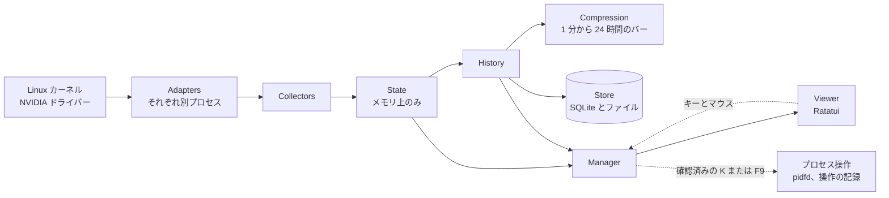

<div align="center">

# dgxtop

**Linux と DGX Spark の NVIDIA GPU 向けターミナルモニター**

すべての GPU、ジョブごとのメモリ使用量、マシン全体を 1 画面で。<br>
GPU ジョブは開始から終了まで、終わり方も含めて記録します。

[English](../README.md) · [繁體中文](README.zh-TW.md) · [プロジェクトページ](https://dennysora.me/ja/projects/tools/dgxtop/) · [仕組み](https://dennysora.me/ja/projects/tools/dgxtop/#architecture)

[](https://github.com/DennySORA/dgxtop/releases/latest)
[](../LICENSE)
[](../rust-toolchain.toml)
[](https://github.com/DennySORA/dgxtop/actions/workflows/ci.yml)


<sub>DGX Spark の Overview。GB10 は CPU とメモリを共有しているため、RAM バーにはシステムの分と、GPU プロセスごとの分がそれぞれの色で表示されます。</sub>

</div>

## インストール

```bash
curl -fsSL https://raw.githubusercontent.com/DennySORA/dgxtop/main/install.sh | bash
```

x86_64 または aarch64 の Linux で、glibc 2.34 以降（Ubuntu 22.04、Debian 12、RHEL 9 以降）。DGX Spark も含みます。WSL 2 では Linux 版が動きます。GPU の値には NVIDIA ドライバーが必要で、ない場合も CPU、メモリ、ディスク、ネットワークは表示します。WSL 1、musl、macOS、Windows には対応していません。

インストーラーは CPU に合ったビルドを選び、リリースの `SHA256SUMS` で検証してから `~/.local/bin` にインストールします。以前のバージョンは残り、`./install.sh --rollback` で戻せます。特定のリリースを入れるには、`bash` の後ろに `-s -- --version v2.5.0` を付けます。

Rust 1.92.0（`rust-toolchain.toml` で固定）を使ってソースからビルドすることもできます：

```bash
git clone https://github.com/DennySORA/dgxtop.git
cd dgxtop
cargo build --release --locked
./target/release/dgxtop
```

## 機能

htop は CPU が中心で、nvtop や nvidia-smi は見ている間だけ GPU を表示します。dgxtop は GPU を中心に、どのジョブが GPU メモリをどれだけ使っているかを示し、すべての GPU ジョブとマシン全体を記録します。

- **すべての GPU をひと目で。** 各 GPU の使用率、メモリ、温度、電力、クロック、ファンをライブグラフ付きで表示します。ゲージ、グラフの各列、温度は 100 段階のグラデーションで色が変わります：0% で緑、50% で橙、100% で赤（温度は 0–100°C の尺度）。
- **プロセスごとのメモリ。** GPU メモリを最も多く使う 8 つのプロセスにはそれぞれ色が付き、メモリバー、グラフ、プロセス表で同じ色を使うので、どのジョブがどれだけ使っているかがひと目でわかります。どれほど少なくても、ジョブはメモリバーに少なくとも 1 マス自分の色を持ちます。DGX Spark では、バーの下のグラフで 1 行に満たない列は 1 行の高さで描かれ、ジョブとシステムに比率で分けられるので、両方の色が常に見えます。色はプロセス名から決まるため、ジョブや dgxtop を再起動しても同じ色のままです（表示中の別のプロセスがその色を使っている場合を除きます）。
- **実行内容で名前を付ける。** `python -m vllm.entrypoints.openai.api_server` は `vllm.api_server`、`ComfyUI` フォルダーで実行した `python main.py` は `ComfyUI/main` と表示され、`python3` にはなりません。
- **GPU プロセス。** GPU を使うすべてのプロセスを、GPU、種別（計算またはグラフィックス）、GPU 使用率、GPU メモリ、CPU、RAM とともに表示します。任意の列で並べ替え、GPU や名前で絞り込み、確認のうえで `K`（SIGTERM）または `F9`（SIGKILL）でプロセスを終了できます。`F9` の直後に押した `y` も有効で、終了したプロセスはすぐに一覧から消えます。
- **Process History。** すべての GPU プロセスを、開始から終了までの 1 回の実行として記録します：実行時間、GPU メモリと RAM のピーク、GPU と CPU の使用率、そして終わり方（終了コードでの終了、シグナルによる終了、dgxtop からの終了、おそらく OOM killer、または実行中）。実行を開くと、完全なコマンドライン、作業フォルダー、そして CPU、メモリ、GPU、スレッド、開いているファイル、ディスク、ネットワークのグラフを表示します。不要になった実行は、1 件ずつ、またはまとめて選んで削除できます。
- **Overview History。** CPU、メモリ、各 GPU の使用率・メモリ・温度・電力、ディスク、ネットワークを、ローカル時刻にそろえた 1 分から 24 時間のバーで表示します。すべてのグラフに現在値、平均、最大値があり、電力のグラフには消費電力量が付きます。GPU が複数あるときは、GPU のグラフに 1 枚ずつ表示します。CPU の電力を読める環境では、電力のグラフは CPU と全 GPU の合計、続いて CPU の電力から始まり、それぞれに消費電力量が付きます。
- **GPU の詳細。** 1 台ずつ表示します：
  - パフォーマンスステート、スロットルの理由とスロットルされた時間、クロック
  - メモリとメモリバス、PCIe リンクと転送量、NVLink-C2C
  - 温度の上限、ファン、電力上限と消費電力量
  - CUDA、ドライバー、NVML、Linux カーネルのバージョン
  - デバイス、PCI とファームウェア、NUMA と CPU アフィニティ、P2P 経路

  GPU が報告しない値は行を作りません。
- **マシン全体。** コアごとの CPU 使用率、CPU 温度と電力、コアの種類ごとの現在と最大の周波数。メモリ、スワップ、バッファー、キャッシュ。ディスクの空き容量、IOPS、レイテンシー、ドライブ温度。ネットワークの転送量、エラー、ドロップ。CPU の電力を読める環境（powercap、または GB10 の電力センサー）では、ヘッダーに CPU と全 GPU の合計電力を表示します。これはコンセント側の消費電力ではなく、どれか 1 つでも読めないときは表示しません。
- **DGX Spark のために。** GB10 のユニファイドメモリでは、RAM バーがシステムの分と GPU ジョブごとの分に分かれます。GB10 の CPU クラスター温度と NVLink-C2C リンクも読み取り、aarch64 ネイティブビルドを提供します。
- **アプリ内の設定。** サンプリング間隔と表示モジュールを変更でき、各データソースの状態も確認できます。各設定の保存値と適用中の値、その出所、すぐ反映されるか再起動が必要かを表示します。

## 画面

### Overview

各 GPU の使用率とメモリ、型番を示した CPU（Arm ではコアの種類ごと。DGX Spark では `10× Cortex-A725 + 10× Cortex-X925`）、メモリ、最も忙しいディスクとネットワークインターフェース、色分けされた GPU プロセス。`c` で CPU をコアごとのバーとセンサーに展開します。`i` / `n` でディスク I/O とネットワークのパネルを 1 行に折りたたむと、残りの行がプロセスに回ります。`o` ですべて展開します（折りたたんだ行のクリックでも可）。折りたためるパネルはタイトルに自分のキーを表示し、折りたたみは再起動後も保たれます。`z` を押すと、GPU プロセスの表が一時的に Overview 全体に広がり、見渡して操作できます。もう一度 `z`、`Esc`、または別の画面に切り替えると元に戻ります。


### GPU

1 台ずつ、上に固定された 4 本のライブバーと、ドライバーが報告するすべての情報を表示します。GB10 のように電力上限を報告しない GPU では、電力バーの最大値はディスクに保存された履歴の直近 30 日間の最大消費電力です。記録が今日より前に届くまでは、消費電力の数値だけを表示します。`←` / `→`（`h` / `l`）で GPU を切り替え、収まらないセクションは次のページに回ります。ページの上の区切り線に現在のページと操作キーが表示され、`↑` / `↓` でページを切り替えます。


<sub>上：ユニファイドメモリと NVLink-C2C を持つ GB10。下：VRAM と PCIe Gen5 の RTX 5080。シリアル番号と UUID は伏せています。</sub>

### Overview History

マシンの各リソースを 1 分から 24 時間のバー（`←` / `→`、または `w` / `W`）で表示し、すべてのグラフに現在値、平均、最大値を表示します。GPU が複数あるときは `↑` / `↓` で GPU のグラフに表示する GPU を選び、グラフが収まらないときは、バーサイズの行の下の区切り線に上下に残るパネルの数が表示され、`PgUp` / `PgDn` でスクロールします。注目するグラフを大きくするには、各パネルのタイトルに表示されたキーでほかのパネルをタイトル行に折りたたみます（ページの先頭にまとまります）：`c` CPU、`m` メモリ、`u` GPU 使用率、`v` GPU メモリ、`t` 温度、`p` 電力、`i` ディスク、`n` ネットワーク。`o` ですべて展開し、折りたたみは再起動後も保たれます。


### Process History

すべての GPU プロセスを実行ごとに表示します。実行中のものが常に一番上、その後は新しい順です：いつ始まり、どれだけ動き、GPU メモリと RAM のピークはいくつで、どう終わったか。`Enter` で実行を開くと、上にその情報（開始・終了時刻、実行時間、親プロセス、作業フォルダー、プログラム、cgroup、コマンドライン。`e` で全体を表示、`y` でコピー）が固定され、その下にグラフを表示します。GPU パネルはタイトルに各 GPU の型番（例：`GPU 0 · RTX 5080`）を示し、その実行が使った GPU ごとに分けて表示します：その GPU での使用率（`util 0`。GB10 のようにドライバーがプロセスごとの使用率を出さない GPU では、その GPU 全体の使用率 `dev 0`）と、その GPU で使ったメモリ（`mem 0`）。4 枚を超える分は合計（`util Σ`、`mem Σ`）に含まれます。`dev` はその GPU 上の全プロセスの合計なので、2 つのジョブが同時に GPU を使うと、どちらの実行にも合計の負荷が表示されます。どの実行が同時に動いていたかは、一覧の開始時刻と実行時間で確認できます。グラフが読める高さで 1 ページに収まらないときはページに分かれ、区切り線に現在のページが表示され、`↑` / `↓` でめくります。`/` で実行を名前か PID で絞り込みます。`g` / `G` で一覧の先頭／末尾へ移動します。`Space` で実行に印を付け、`a` で終了済みの実行すべてに印を付け、`d` で確認のうえ印を付けた実行（印がなければ選択中の実行）を削除します。実行中のものは残ります。


<sub>この実行のフォルダー、プログラム、cgroup、コマンドラインは伏せています。</sub>

## 特長

- **1 台のマシンに複数の GPU。** DGX Spark（GB10）と、RTX 5080 と RTX 3060 を積んだワークステーションでテスト済みです。各 GPU は番号の横に型番が付き（`GPU 0 · RTX 5080`）、固有の色を持ちます。色はどの画面でも同じです。番号はドライバーのもので、`nvidia-smi` の表示と同じです。CUDA は `CUDA_DEVICE_ORDER=PCI_BUS_ID` を設定しない限り最も速い GPU を先に数えるため、ジョブの `cuda:0` が `GPU 0` とは別のカードのことがあります。
- **長く残る履歴。** 履歴はディスクに保存され、再起動しても残り、保存期限はありません。バーの大きさごとに最新の 300 本を残すので、1 分バーは直近 5 時間、24 時間バーは約 10 か月をカバーします。Process History は最新の 512 回の実行を表示します。記録するのは dgxtop の実行中です。
- **軽量。** Rust 製です。新しいデータの描画は既定で毎秒 4 回、データは固定の 256 MiB に収めます。
- **どの端末サイズでも。** ワイド、1 カラム、コンパクトのレイアウトで、40×10 まで対応します。キーボードとマウス、4 つの配色テーマに対応しています。
- **プライバシー。** ネットワークアクセスもテレメトリーもありません。設定と履歴は本人だけが読めるファイルです。Process History は GPU プロセスのコマンドライン、作業フォルダー、プログラムを保存しますが、環境変数は保存しません。
- **安全なプロセス操作。** 操作できるのは自分のプロセスだけで（`sudo` で起動した場合は `sudo` を実行したユーザーのプロセス。root で直接ログインした場合は操作できません）、期限付きの確認の後にだけ実行します。シグナルは pidfd 経由で送るので、再利用された PID に届くことはなく、すべての操作を記録します。`--read-only` で無効にできます。
- **安全な更新。** インストーラーはダウンロードしたファイルをすべて検証し、以前のバージョンを残すので、1 コマンドで戻せます。

## アーキテクチャ

dgxtop は 1 つのプログラムです。Adapter がそれぞれのバックグラウンドプロセスでハードウェアを読み、読み取った値はデータ経路を流れ、Manager が画面に描く表示用データにまとめます。



| 構成要素 | 役割 |
|---|---|
| Adapters | ハードウェアを読みます：`/proc`、hwmon、thermal zone、powercap、GPU の NVML、ネットワーク、ファイルシステム。それぞれ専用のバックグラウンドプロセスで動きます。読み取り専用のプローブが各 GPU プロセスを追跡します。 |
| Collectors | 読み取り値を指標に整えます：単位、値ごとの最適な出所、カウンターからのレート、プロセスごとに 1 件の記録。 |
| State | ライブスナップショットと短期のトレンドを、メモリ上にだけ保持します。 |
| History | Overview History と Process History を保持し、何を残し何を手放すかを決めます。 |
| Compression | サンプルを、ローカル時刻にそろえた 1 分から 24 時間のバーにまとめます。 |
| Store | SQLite データベースとファイルを、頼まれたとおりにだけ読み書きします。 |
| Manager | サンプリングの計画、設定の適用、コマンドとプロセス操作の確認を行い、表示用データを作ります。自身はデータを持ちません。 |
| Viewer | Manager の表示用データから Ratatui で画面を描き、キーやマウス操作をコマンドに変換します。 |
| Runtime | adapter プロセス、その IPC と上限付きのキュー、ログ、端末を管理します。 |

プロジェクトページの[技術解説](https://dennysora.me/ja/projects/tools/dgxtop/#architecture)では、1 つのサンプルをカーネルから画面まで追い、adapter プロセス、出所の選択、階層化された履歴、Process History、GPU メモリの色分け、安全なプロセス操作、上限と過負荷、ディスク上のファイルを、図とともに説明しています。

<details>
<summary>コードの構成</summary>

コードは、共通の契約 crate を中心にした 11 個の crate からなる Rust workspace です。

| Crate | 内容 |
|---|---|
| `dgxtop` | プログラム本体：コマンドライン、モード、起動、組み立て |
| `dgxtop-core` | 共通の型：指標、コマンド、表示用データ、構成要素間のインターフェース |
| `dgxtop-runtime` | バックグラウンドプロセス、IPC、キュー、ログ、端末、タイムゾーン |
| `dgxtop-adapters` | procfs、hwmon、thermal、powercap、NVML、ネットワーク、ファイルシステム、プロセスのプローブとプロセス操作 |
| `dgxtop-collectors` | 読み取り値からの指標：レート、出所の選択、プロセスの記録 |
| `dgxtop-state` | ライブスナップショットと短期のトレンド |
| `dgxtop-history` | Overview History、Process History と、それぞれが残すもの |
| `dgxtop-compression` | 1 分から 24 時間のバー |
| `dgxtop-store` | SQLite データベースとファイル |
| `dgxtop-manager` | スケジューリング、設定、セッション、プロセス操作、表示用データ |
| `dgxtop-ui` | 画面、ウィジェット、キーマップ |

</details>

## 使い方

```bash
dgxtop                       # ライブモニター
dgxtop -i 0.5                # この実行だけ 0.5 秒ごとにサンプリング（保存済み設定は変更しない）
dgxtop -t amber              # この実行の配色テーマ：dark、cyan、green、amber
dgxtop --no-gpu              # NVML host を起動しない
dgxtop --read-only           # プロセス操作を無効化
sudo -H dgxtop --any-user    # K／F9 で全ユーザーのプロセスを終了（root で動かす htop と同様）
dgxtop --replay fixture.json # シミュレーションデータのみ、読み取り専用、別の一時状態
dgxtop --check-config        # 設定を検証し、保存値と適用中の値を表示
dgxtop --diagnostics-json    # バージョン、SQLite、機能、ヘルスを JSON で出力
dgxtop --import-legacy ~/.config/dgxtop/config.json --dry-run   # v1 → v2 の対応を表示
dgxtop --version --verbose   # バージョン、commit、ツールチェーン、ターゲット、SQLite ランタイム
```

**CPU 電力と合計電力：** root 権限が必要な CPU 電力データを読むには、`sudo` で dgxtop を起動してください。Linux の powercap/RAPL エネルギーカウンターは通常 root だけが読み取れます。権限がない場合、GPU 電力が取得できても、CPU 電力と CPU＋GPU の合計電力は表示されません。

```bash
sudo -H "$HOME/.local/bin/dgxtop"  # 上記のインストーラーでインストールした場合
sudo -H ./target/release/dgxtop   # ソースからビルドした場合。リポジトリー内で実行
```

ハードウェアとドライバーが CPU 電力データを提供し、すべての GPU が電力を報告できる場合に合計を表示します。`sudo` でも存在しないセンサーの値は取得できません。デフォルトのパスでは、上記のコマンドは root の設定と履歴を使います。プロセスの終了操作（`K`／`F9`）は `sudo` を実行したユーザーとして動作し、そのユーザーのプロセスだけを終了でき、root や他のユーザーのプロセスには届きません。`sudo` を経由しない root セッションではプロセスを終了できません。`--any-user` を付けると、その実行に限りこの制限を外せます（root で動かす `htop` と同様）。`K`／`F9` は OS が root に許すすべてのプロセス（root や他のユーザー、コンテナー内のプロセスを含む）に届き、PID 1 と dgxtop 自身のプロセスは保護されたままで、ヘッダーに `ANY-USER` と表示されます。

`--config` と `--state-dir` には、設定ファイルと状態ディレクトリーの絶対パスを指定します。コマンドライン引数は、その実行に限って保存済み設定を上書きします。

各パネルはタイトルの右側に自分のキーを表示し、ページのある画面ではページの上の区切り線にページ送りのキーを表示します。フッターには全体のキーだけを残します。矢印キーのないキーボードでは、`h` / `j` / `k` / `l` が `←` / `↓` / `↑` / `→` の、`Ctrl-U` / `Ctrl-D` が `PgUp` / `PgDn` の、`<` / `>` が `Home` / `End` の代わりになります。

| キー | 動作 |
|---|---|
| `1`–`5`、`Tab`、`Shift-Tab` | Overview、GPU、Overview History、Process History、Settings |
| `q`、`Ctrl-C` | 終了（フィルター入力中の `q` は文字入力、`Ctrl-C` は常に終了） |
| `+` / `-` | サンプリングを速く／遅く |
| `j`/`k`、矢印、`PgUp`/`PgDn`（`Ctrl-U`/`Ctrl-D`）、`Home`/`End`（`<`/`>`） | Overview と Settings で選択を移動 |
| `c` | CPU センサーとコアごとのバーの表示切替（CPU パネルのクリックでも可） |
| `i` / `n`、`o` | Overview のディスク I/O／ネットワークのパネルを 1 行に折りたたむ、またはすべて展開（再起動後も保持） |
| `[` / `]` | メモリパネルの GPU プロセスをスクロール |
| `z` | GPU プロセスの表を一時的に Overview 全体に表示、または元に戻す（`Esc` でも可） |
| `s` / `r` | 次のソート列／逆順 |
| `g` | GPU フィルターを切替（全 GPU → 各 GPU） |
| `/` | プロセスや Process History の実行を名前か PID でフィルター（`Enter` で適用、`Esc` でクリア；`Ctrl-B`/`Ctrl-F`/`Ctrl-A`/`Ctrl-E` でカーソル移動） |
| `K` / `F9` | 選択したプロセスを SIGTERM／SIGKILL で終了（確認あり。確認が表示される前に押した `y` も有効） |
| `y`/`Enter`、`n`/`Esc` | 保留中のプロセス操作または削除を確認／取消 |
| `h`/`l`、`←`/`→` | GPU ビューで前／次の GPU；履歴ビューで前／次のバーの大きさ（`W` / `w` も可） |
| `k`/`j`、`↑`/`↓` | GPU ビューと開いた実行のグラフで前／次のページ；Process History の一覧で前／次の実行；Overview History の GPU グラフで前／次の GPU |
| `PgUp`/`PgDn`、`Ctrl-U`/`Ctrl-D` | GPU ビューと開いた実行のグラフで前／次のページ；Overview History のグラフが収まらないときにスクロール |
| `g`/`Home`/`<`、`G`/`End`/`>` | Process History の一覧の先頭／末尾；開いた実行と GPU ビューの最初／最後のページ；Overview History の最初／最後のグラフ |
| `c`/`m`/`u`/`v`/`t`/`p`/`i`/`n`、`o` | Overview History のパネル（CPU、メモリ、GPU 使用率、GPU メモリ、温度、電力、ディスク、ネットワーク）をタイトル行に折りたたむ、またはすべて展開（再起動後も保持） |
| `Enter` | Process History で選択した実行を開く／閉じる |
| `e` / `y` | 開いた実行のコマンドライン全体を表示／コピー（OSC 52） |
| `Space` | Process History で選択した実行に印を付ける／外す；Settings で選択した表示モジュールのオン・オフ |
| `a` | Process History で終了済みの実行すべてに印を付ける、またはすべて外す（`Esc` で印をクリア） |
| `d`、`Delete` | 印を付けた実行（なければ選択中の実行）を Process History から削除（確認あり。実行中のものは残る） |

## 設定とファイル

| 用途 | 場所 |
|---|---|
| 設定と折りたたんだパネル | `$XDG_CONFIG_HOME/dgxtop/v2/config.json`（`~/.config/dgxtop/v2/config.json`） |
| Overview History：すべてのバー（約 40 MiB） | `$XDG_STATE_HOME/dgxtop/v2/history_tiers.sqlite3`（`~/.local/state/...`） |
| Overview History：直近の分単位のデータ（7 日、最大 1 GiB） | `$XDG_STATE_HOME/dgxtop/v2/history.sqlite3` |
| Process History（約 40 MiB） | `$XDG_STATE_HOME/dgxtop/v2/process_history.sqlite3` と `process_recent.json` |
| プロセス操作の記録（30 日） | `$XDG_STATE_HOME/dgxtop/v2/audit.sqlite3` |
| ログとインスタンスロック | `$XDG_STATE_HOME/dgxtop/v2/dgxtop.log`、`instance.lock` |

ディレクトリは `0700`、ファイルは `0600` で作成します。データベースがいっぱいになると、古いデータから手放します。Process History では、最も長く見ていない終了済みの実行からです。形式の異なる以前のバージョンのデータベースは、移行せずに空で作り直します。`config.json` は常に残ります。v1 からのアップグレードでは `~/.config/dgxtop/config.json` を変更しません。`--import-legacy <path> --dry-run` で対応を確認してから、`--apply` で v2 の設定ファイルを書き込みます。

## ライセンス

Apache-2.0。[LICENSE](../LICENSE) を参照してください。
