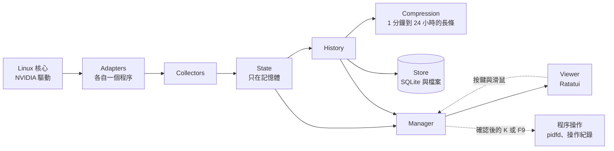

<div align="center">

# dgxtop

**Linux 與 DGX Spark 上的 NVIDIA GPU 終端監控工具**

所有 GPU、每個工作佔用多少記憶體與整台機器，一個畫面看完；<br>
每個 GPU 工作從開始到結束都有紀錄，包括它怎麼結束。

[English](../README.md) · [日本語](README.ja.md) · [專案頁面](https://dennysora.me/zh-hant/projects/tools/dgxtop/) · [運作原理](https://dennysora.me/zh-hant/projects/tools/dgxtop/#architecture)

[](https://github.com/DennySORA/dgxtop/releases/latest)
[](../LICENSE)
[](../rust-toolchain.toml)
[](https://github.com/DennySORA/dgxtop/actions/workflows/ci.yml)


<sub>DGX Spark 上的總覽。GB10 與 CPU 共用記憶體，所以 RAM 長條會分出系統佔用的部分，以及每個 GPU 程序各自上色的部分。</sub>

</div>

## 安裝

```bash
curl -fsSL https://raw.githubusercontent.com/DennySORA/dgxtop/main/install.sh | bash
```

支援 x86_64 或 aarch64 的 Linux，glibc 2.34 以上（Ubuntu 22.04、Debian 12、RHEL 9 及更新版本），包括 DGX Spark。WSL 2 可以執行 Linux 版。GPU 指標需要 NVIDIA 驅動；沒有驅動時，CPU、記憶體、磁碟與網路照常顯示。不支援 WSL 1、musl、macOS 與 Windows。

安裝程式會依 CPU 選擇對應的版本，以 release 的 `SHA256SUMS` 驗證後安裝到 `~/.local/bin`。舊版本會保留，執行 `./install.sh --rollback` 就能還原。要安裝特定版本，在 `bash` 後面加上 `-s -- --version v2.1.0`。

也可以用 Rust 1.92.0 從原始碼建置（由 `rust-toolchain.toml` 固定）：

```bash
git clone https://github.com/DennySORA/dgxtop.git
cd dgxtop
cargo build --release --locked
./target/release/dgxtop
```

## 功能

htop 以 CPU 為主，nvtop 和 nvidia-smi 只在你盯著的時候顯示 GPU。dgxtop 以 GPU 為主，顯示每個工作佔用多少 GPU 記憶體，並記錄每個 GPU 工作與整台機器。

- **一眼看完所有 GPU。** 每張 GPU 的使用率、記憶體、溫度、功耗、時脈與風扇，附即時圖表。量表、圖表的每一欄與溫度都以 100 階漸層上色：0% 綠、50% 橘、100% 紅（溫度以 0–100°C 計）。
- **依程序區分記憶體。** 佔用 GPU 記憶體最多的八個程序各有一種顏色，記憶體長條、圖表與程序表都用同一種顏色，一眼看出哪個工作佔用多少。顏色由程序名稱決定，所以工作或 dgxtop 重開後顏色不變，除非另一個列出的程序已經佔用那個顏色。
- **用實際執行的程式命名。** `python -m vllm.entrypoints.openai.api_server` 顯示為 `vllm.api_server`，在 `ComfyUI` 資料夾執行的 `python main.py` 顯示為 `ComfyUI/main`，而不是 `python3`。
- **GPU 程序。** 所有使用 GPU 的程序，以及所在的 GPU、類型（運算或圖形）、GPU 使用率、GPU 記憶體、CPU 與 RAM。可依任一欄排序、依 GPU 或名稱篩選，確認後用 `K`（SIGTERM）或 `F9`（SIGKILL）結束程序。
- **程序歷史（Process History）。** 每個 GPU 程序從開始到結束都記錄成一次執行：執行時間、GPU 記憶體與 RAM 峰值、GPU 與 CPU 使用率，以及結束方式：以結束碼結束、被訊號終止、從 dgxtop 結束、很可能是 OOM killer，或仍在執行。打開一次執行，可以看到完整命令列、工作目錄，以及 CPU、記憶體、GPU、執行緒、開啟的檔案、磁碟與網路的圖表。
- **總覽歷史（Overview History）。** CPU、記憶體、每張 GPU 的使用率、記憶體、溫度與功耗、磁碟與網路，以 1 分鐘到 24 小時、對齊本地時間的長條呈現；每張圖都有目前值、平均與最大值，並列出每張 GPU 的平均、峰值與耗電量。讀得到 CPU 功耗時，功耗圖會先列 CPU 加所有 GPU 的總功耗與 CPU 功耗，各附耗電量。
- **完整的 GPU 細節。** 一次看一張 GPU：
  - 效能狀態、降頻原因與降頻時間、時脈；
  - 記憶體與記憶體匯流排、PCIe 連線與流量、NVLink-C2C；
  - 溫度上限、風扇、功耗上限與耗電量；
  - CUDA、驅動、NVML 與 Linux 核心版本；
  - 裝置、PCI 與韌體、NUMA 與 CPU 親和性、P2P 路徑。

  GPU 不回報的值不會佔一行。
- **整台機器。** 每顆核心的 CPU 使用率、CPU 溫度與功耗，以及每種核心目前與最高的頻率；記憶體、swap、緩衝區與快取；磁碟的可用空間、IOPS、延遲與硬碟溫度；網路流量、錯誤與丟包。讀得到 CPU 功耗時（powercap，或 GB10 的功耗感測器），頂端標題列會顯示 CPU 與所有 GPU 的總功耗；這不是插座端的整機功耗，任一部分讀不到時就不顯示。
- **為 DGX Spark 打造。** 在 GB10 的統一記憶體上，RAM 長條會分出系統佔用與每個 GPU 工作佔用的部分。dgxtop 也會讀取 GB10 的 CPU 叢集溫度與 NVLink-C2C 連線，並提供原生 aarch64 版本。
- **程式內設定。** 調整採樣間隔與顯示模組，並查看每個資料來源的狀態。每項設定都顯示儲存值與生效值、來源，以及是立即生效還是重開後生效。

## 畫面

### 總覽

每張 GPU 的使用率與記憶體、CPU、記憶體、最忙的磁碟與網路介面，以及上色的 GPU 程序。按 `c` 會把 CPU 展開成每顆核心的長條與感測器。


### GPU

一次看一張 GPU：四條即時長條，接著是驅動回報的所有資訊。用 `h` / `l` 切換 GPU。


<sub>上：GB10，統一記憶體與 NVLink-C2C；下：RTX 5080，VRAM 與 PCIe Gen5。序號與 UUID 已遮蔽。</sub>

### 總覽歷史

整台機器的各項資源，以 1 分鐘到 24 小時的長條呈現（`w` / `W`），每張圖都有目前值、平均與最大值；下方是每張 GPU 的平均與峰值。


### 程序歷史

每個 GPU 程序都是一次執行，最新的在最上面：何時開始、執行多久、GPU 記憶體與 RAM 峰值，以及結束方式。按 `Enter` 打開一次執行，可以看到命令列（`e` 顯示全部、`y` 複製）、工作目錄與圖表。


<sub>這次執行的目錄、程式、cgroup 與命令列已遮蔽。</sub>

## 能力

- **一台機器多張 GPU。** 已在 DGX Spark（GB10）與裝有 RTX 5080 和 RTX 3060 的工作站上測試。
- **長久保存的歷史。** 歷史寫入磁碟，重開程式或重開機都還在，沒有保存期限：每種長條保留最新的 300 條，所以 1 分鐘長條涵蓋最近 5 小時，24 小時長條大約 10 個月。程序歷史列出最新的 512 次執行。dgxtop 在執行期間記錄。
- **輕量。** 以 Rust 撰寫。預設每秒繪製 4 次新資料，資料使用量固定在 256 MiB 以內。
- **任何終端尺寸。** 寬版、單欄與精簡版面，最小到 40×10。支援鍵盤與滑鼠，有四種配色主題。
- **隱私。** 不連網，也不回傳任何資料。設定與歷史是只有你能讀的檔案。程序歷史會保存 GPU 程序的命令列、工作目錄與程式；環境變數從不儲存。
- **安全的程序操作。** 只能操作自己的程序，root 工作階段不能操作，而且要在會過期的確認之後才執行。訊號經由 pidfd 送出，不會誤送到重複使用的 PID，每次操作都有紀錄。`--read-only` 可以關閉程序操作。
- **安全升級。** 安裝程式會驗證每個下載的檔案，並保留上一版，一個指令就能還原。

## 架構

dgxtop 是單一程式。Adapter 在各自的背景程序中讀取硬體，讀值沿著資料路徑往下流，Manager 再把它們整理成畫面要繪製的內容。



| 元件 | 功能 |
|---|---|
| Adapters | 讀取硬體：`/proc`、hwmon、thermal zone、powercap、GPU 的 NVML、網路與檔案系統，各自在背景程序中執行。唯讀的探測器會追蹤每個 GPU 程序。 |
| Collectors | 把原始讀值整理成指標：單位、每個值的最佳來源、由計數器算出的速率，每個程序一筆紀錄。 |
| State | 保存即時快照與短期趨勢，只放在記憶體中。 |
| History | 保存總覽歷史與程序歷史，並決定保留什麼、淘汰什麼。 |
| Compression | 把樣本合併成 1 分鐘到 24 小時、對齊本地時間的長條。 |
| Store | 讀寫 SQLite 資料庫與檔案，只執行收到的請求。 |
| Manager | 排定採樣、套用設定、檢查指令與程序操作，並產生畫面資料。本身不保存資料。 |
| Viewer | 用 Manager 產生的畫面資料，以 Ratatui 繪製畫面，並把按鍵與滑鼠點擊轉成指令。 |
| Runtime | 管理 adapter 程序、它們的 IPC 與有上限的佇列、日誌與終端。 |

專案頁面上的[技術深入解析](https://dennysora.me/zh-hant/projects/tools/dgxtop/#architecture)先跟著一筆資料從核心走到畫面，再說明 adapter 子程序、來源仲裁、分層歷史、程序歷史、GPU 記憶體的配色、安全的程序操作、上限與過載，以及磁碟上的檔案，每一節都附圖。

<details>
<summary>程式碼結構</summary>

程式碼是 11 個 crate 組成的 Rust workspace，圍繞一個共用的契約 crate。

| Crate | 內容 |
|---|---|
| `dgxtop` | 主程式：命令列、模式、啟動與組裝 |
| `dgxtop-core` | 共用型別：指標、指令、畫面資料與元件之間的介面 |
| `dgxtop-runtime` | 背景程序、IPC、佇列、日誌、終端與時區 |
| `dgxtop-adapters` | procfs、hwmon、thermal、powercap、NVML、網路、檔案系統、程序探測與程序操作 |
| `dgxtop-collectors` | 由讀值產生指標：速率、來源選擇與程序紀錄 |
| `dgxtop-state` | 即時快照與短期趨勢 |
| `dgxtop-history` | 總覽歷史、程序歷史與各自保留的內容 |
| `dgxtop-compression` | 1 分鐘到 24 小時的長條 |
| `dgxtop-store` | SQLite 資料庫與檔案 |
| `dgxtop-manager` | 排程、設定、工作階段、程序操作與畫面資料 |
| `dgxtop-ui` | 畫面、元件與按鍵對應 |

</details>

## 使用方式

```bash
dgxtop                       # 即時監控
dgxtop -i 0.5                # 本次每 0.5 秒採樣（不更改已保存的設定）
dgxtop -t amber              # 本次的配色主題：dark、cyan、green 或 amber
dgxtop --no-gpu              # 不啟動 NVML host
dgxtop --read-only           # 不允許程序操作
dgxtop --replay fixture.json # 只用模擬資料、唯讀、使用獨立的暫存狀態
dgxtop --check-config        # 驗證設定並列出儲存值與生效值
dgxtop --diagnostics-json    # 以 JSON 輸出版本、SQLite、能力與健康狀態
dgxtop --import-legacy ~/.config/dgxtop/config.json --dry-run   # 顯示 v1 → v2 的對應
dgxtop --version --verbose   # 版本、commit、工具鏈、target、SQLite runtime
```

`--config` 與 `--state-dir` 以絕對路徑指定設定檔與狀態目錄。命令列參數只在本次執行時覆寫已保存的設定。

每個面板的標題右側列出它自己的按鍵；底部只保留全域按鍵。

| 按鍵 | 動作 |
|---|---|
| `1`–`5`、`Tab`、`Shift-Tab` | 總覽、GPU、總覽歷史、程序歷史、設定 |
| `q`、`Ctrl-C` | 離開（輸入篩選時 `q` 是文字；`Ctrl-C` 一律離開） |
| `?`、`F1` | 說明 |
| `+` / `-` | 加快／放慢採樣 |
| `j`/`k`、方向鍵、`PgUp`/`PgDn`、`Home`/`End` | 移動選取 |
| `c` | 顯示／隱藏 CPU 感測器與各核心長條（也可點擊 CPU 面板） |
| `[` / `]` | 捲動記憶體面板中的 GPU 程序 |
| `s` / `r` | 下一個排序欄位／反轉順序 |
| `g` | 循環切換 GPU 篩選（全部 → 各張 GPU） |
| `/` | 依名稱篩選程序（`Enter` 套用、`Esc` 清除） |
| `K` / `F9` | 以 SIGTERM／SIGKILL 結束選取的程序（需要確認） |
| `y`/`Enter`、`n`/`Esc` | 確認／取消待執行的程序操作 |
| `h`/`l`、`←`/`→` | GPU 頁面切換上一張／下一張 GPU |
| `w`/`W`、`→`/`←` | 歷史畫面的下一個／上一個長條大小 |
| `Enter` | 在程序歷史中打開或關閉選取的執行 |
| `e` / `y` | 顯示打開的執行的完整命令列／複製（OSC 52） |
| `Space` | 在設定頁開關選取的顯示模組 |

## 設定與檔案

| 用途 | 位置 |
|---|---|
| 設定 | `$XDG_CONFIG_HOME/dgxtop/v2/config.json`（`~/.config/dgxtop/v2/config.json`） |
| 總覽歷史：各種長條（約 40 MiB） | `$XDG_STATE_HOME/dgxtop/v2/history_tiers.sqlite3`（`~/.local/state/...`） |
| 總覽歷史：最近的每分鐘資料（7 天、最多 1 GiB） | `$XDG_STATE_HOME/dgxtop/v2/history.sqlite3` |
| 程序歷史（約 40 MiB） | `$XDG_STATE_HOME/dgxtop/v2/process_history.sqlite3` 與 `process_recent.json` |
| 程序操作紀錄（30 天） | `$XDG_STATE_HOME/dgxtop/v2/audit.sqlite3` |
| 日誌與執行個體鎖 | `$XDG_STATE_HOME/dgxtop/v2/dgxtop.log`、`instance.lock` |

目錄以 `0700`、檔案以 `0600` 建立。資料庫滿了時，最舊的資料先讓出空間：程序歷史中是最久沒出現的已結束執行。格式不同的舊版資料庫會重新建立為空的，不做遷移；`config.json` 一律保留。從 v1 升級不會修改 `~/.config/dgxtop/config.json`：先用 `--import-legacy <path> --dry-run` 檢查對應，再用 `--apply` 寫入 v2 設定檔。

## 授權

Apache-2.0，見 [LICENSE](../LICENSE)。
