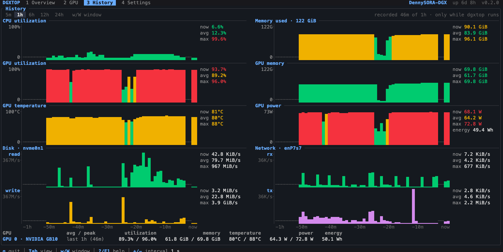
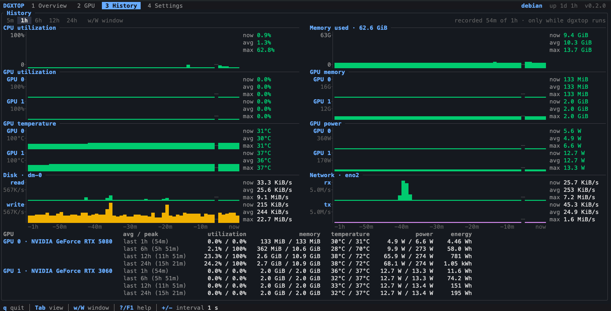
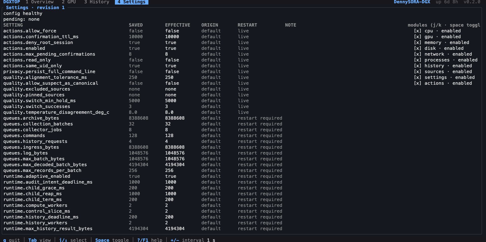
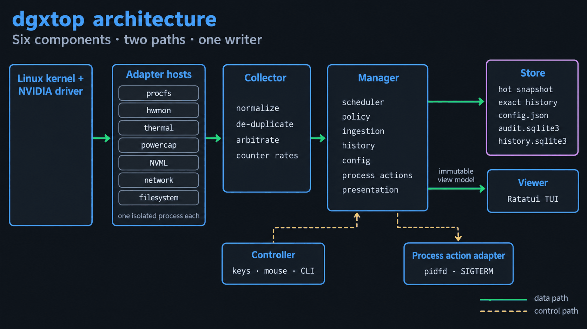
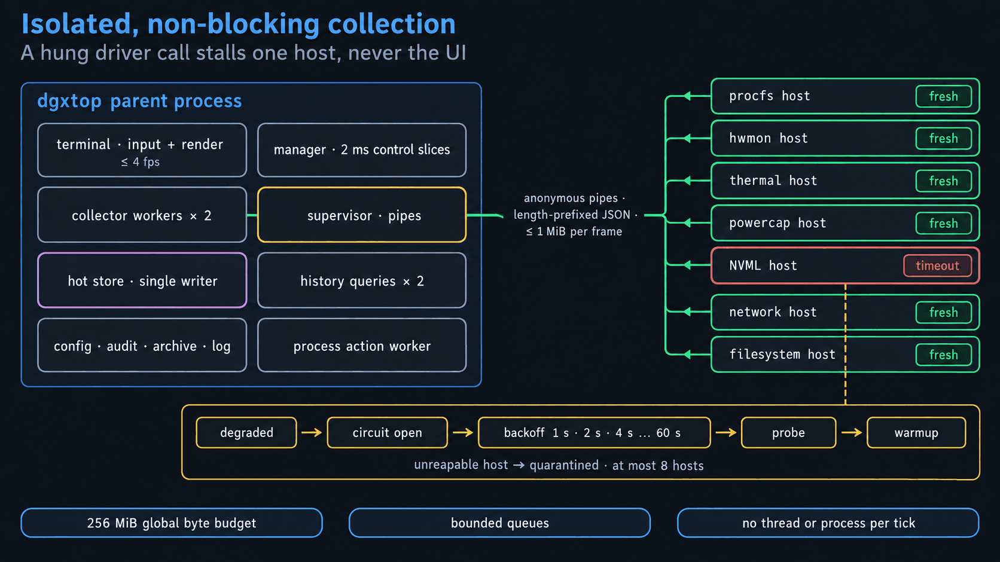
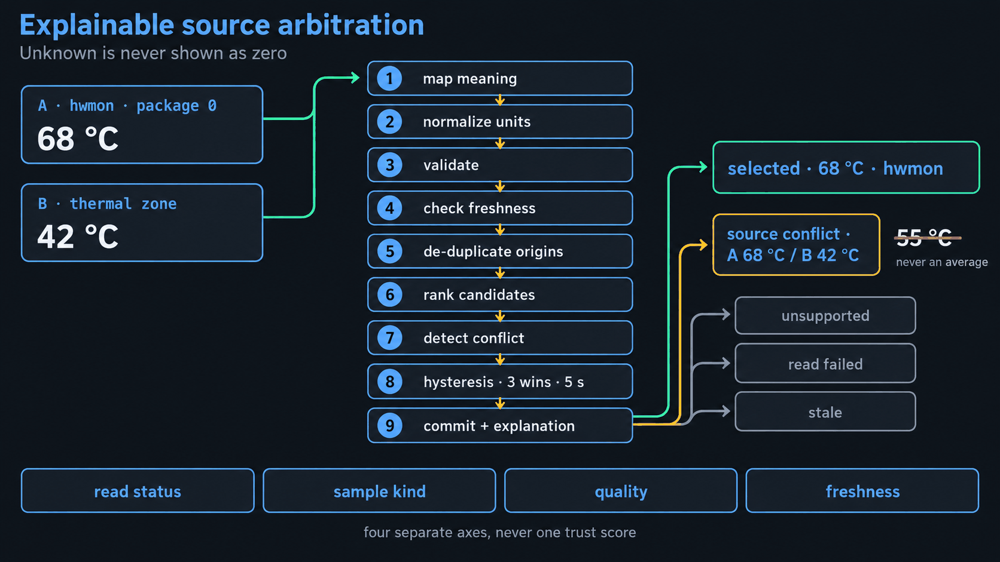
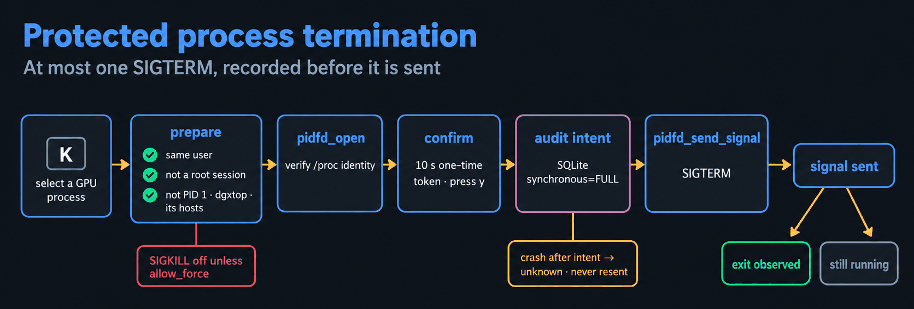
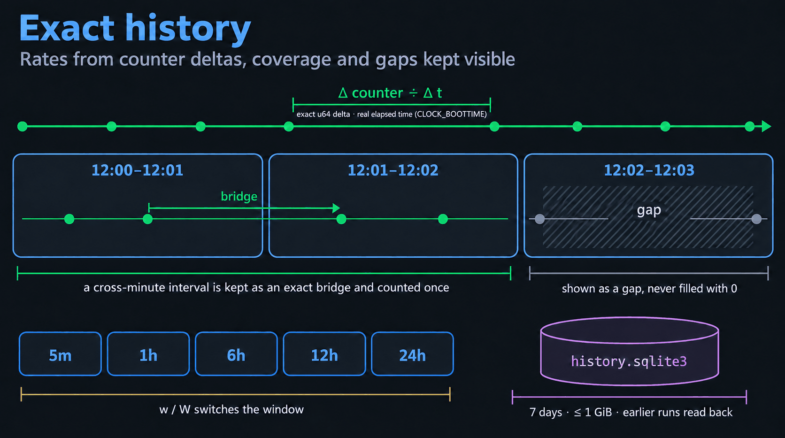
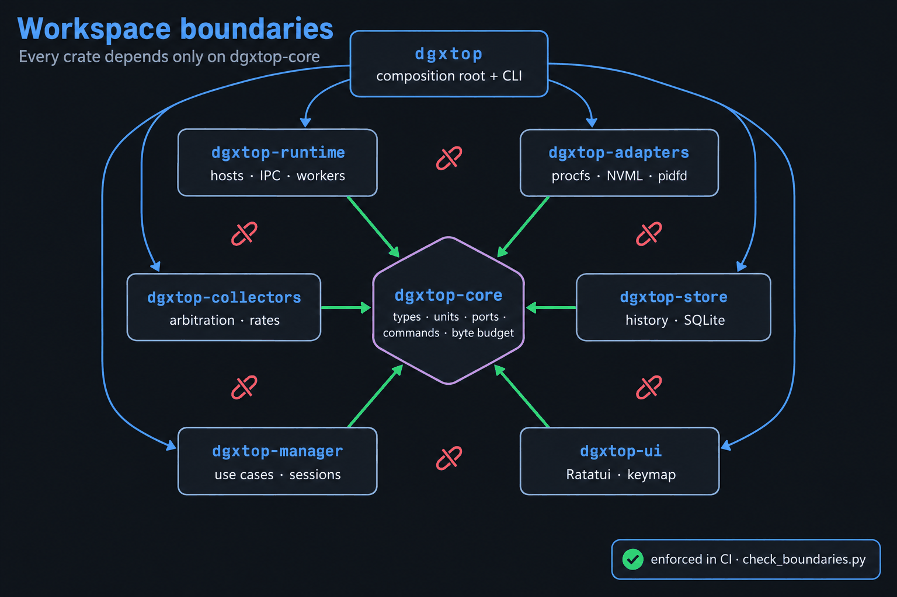

<div align="center">

# dgxtop

**給 NVIDIA DGX Spark 與 GPU Linux 主機的誠實終端監控工具**

CPU · GPU · 記憶體 · 磁碟 · 網路 · GPU 程序<br>
隔離採集 · 可解釋的來源 · 精確歷史 · 受保護的程序控制

[English](../README.md) · [日本語](README.ja.md) · [設計說明](https://dennysora.me/zh-hant/projects/tools/dgxtop/)

[](../LICENSE)
[](../rust-toolchain.toml)
[](https://github.com/DennySORA/dgxtop/actions/workflows/ci.yml)


<sub>DGX Spark 上的總覽。GB10 與 CPU 共用記憶體，所以 GPU 程序佔用的 RAM 直接畫在系統記憶體裡。</sub>

</div>

dgxtop 不會顯示假的 0。讀不到的值會標示為**不支援**、**讀取失敗**、**過期**或**來源衝突**，並附上資料來源。

## 畫面

### 總覽（Overview）

CPU 與記憶體、每張 GPU 的使用率與記憶體、最忙的磁碟與網路介面，以及有使用 GPU 的程序。忙碌的時段一眼就是紅色；按 `c` 會加入所有 CPU 感測器與各核心長條。


### GPU

一次看一張 GPU：上方四條即時長條，下方是驅動回報的全部資訊，從 NVML 與 CUDA toolkit 的檔案讀取，不執行任何指令。GPU 沒有回報的值就不列出。


<sub>上：GB10，統一記憶體與 NVLink-C2C；下：RTX 5080，獨立 VRAM 與 PCIe Gen5。序號與 UUID 已打碼。</sub>

### 歷史（History）

把總覽的資源拉長到 5 分鐘至 24 小時（`w` / `W` 切換），成對的面板共用同一條時間軸。每條圖都有刻度、依數值上色的每欄平均，以及 now／avg／max。時間軸下方是每張 GPU 最近 1、6、12、24 小時的統計。歷史存在 `history.sqlite3`，之前執行的紀錄也會畫出來。





### 設定（Settings）

每個設定的已保存值、生效值、來源，以及是否即時生效或需要重新啟動；顯示模組可以個別開關。



## 為什麼是 dgxtop

- **不顯示假的 0。** 讀取狀態、資料種類（量測、衍生、估算、模擬）、品質與新鮮度是分開的軸。未經證實的單位不靠猜測換算，也不從使用率百分比捏造頻寬。
- **驅動卡住不會讓畫面凍結。** 每個 live 資料來源都在自己的常駐 host 程序裡執行。NVML 呼叫卡死只影響那個 host，CPU、記憶體與 UI 照常更新。
- **可解釋的來源。** 已證明是同一顆感測器的別名只算一票；獨立來源互相矛盾時顯示「來源衝突」，不取平均。
- **精確的歷史。** 速率來自精確的 `u64` counter 差值除以真實經過時間，空窗一律看得到。
- **有界的資源。** 所有受管資料共用一份 256 MiB 預算，每條佇列都有位元組與筆數上限；執行緒數量固定；只在有變化時重繪，最多 4 fps。
- **受保護的程序控制。** `K` 對選取的 GPU 程序請求 SIGTERM：僅限同使用者、需在 10 秒內一次性確認、送訊號**之前**先寫入稽核，並透過預先持有的 `pidfd` 送出。

## 架構

### 六個元件、兩條路徑、單一寫入者



資料從核心與驅動出發，經過隔離的 adapter host 到 Collector（正規化與仲裁），再到 Store 唯一的寫入者 Manager。Viewer 只畫不可變的 view model；Controller 只把按鍵轉成命令。

### 隔離、不阻塞的採集



逾時的 host 會退避（1 秒、2 秒、4 秒……最多 60 秒），而且只有在確實回收後才重啟；無法回收的 host 會被隔離，不會無限重生。

### 可解釋的來源仲裁



要切換到另一個來源，必須連續勝出 3 次且至少經過 5 秒，數值不會在感測器之間來回跳。

### 受保護的程序終止



結果會分開標示「已送出訊號」與「已觀察到結束」。`SIGKILL` 預設停用，除非啟用 `actions.allow_force`；`--read-only` 會停用所有操作。

### 精確的歷史



時窗總量只計入完全落在窗內的區間；跨分鐘的區間以精確的 bridge 保存，不靠猜測拆分。

### Workspace 邊界



<details>
<summary>各 crate 的職責</summary>

| Crate | 職責 |
|---|---|
| `dgxtop-core` | 型別化身分、單位、品質軸、命令、事件、設定、位元組預算、ports |
| `dgxtop-runtime` | adapter-host 監管與 IPC framing、有界 worker、不阻塞的終端輸出 |
| `dgxtop-adapters` | 唯讀 adapter（procfs、hwmon、thermal、powercap、NVML、network、filesystem、replay）與獨立的 pidfd 操作 adapter |
| `dgxtop-collectors` | 正規化、同源去重、仲裁、counter 速率、程序與 GPU 關聯 |
| `dgxtop-store` | 即時快照、有界精確歷史、設定 repository、SQLite 稽核與封存 |
| `dgxtop-manager` | 排程、目錄、政策、資料提交、歷史、設定、程序操作、呈現、會話 |
| `dgxtop-ui` | 顯示模組、排版、keymap、controller、終端 runner |
| `dgxtop` | 組裝根（composition root）與 CLI |

CI 以 [`spec/dgxtop-v2/tools/check_boundaries.py`](../spec/dgxtop-v2/tools/check_boundaries.py) 檢查這條邊界。

</details>

## 安裝

支援 x86_64 或 aarch64 的 Linux（glibc）。GPU 指標需要 NVIDIA 驅動（NVML）；沒有驅動時其他功能照常運作。從原始碼建置（`rust-toolchain.toml` 固定 Rust 1.92.0）：

```bash
git clone https://github.com/DennySORA/dgxtop.git
cd dgxtop
cargo build --release --locked
./target/release/dgxtop
```

第一個 v2 release 還沒有發佈；GitHub 上最新的 release（v0.2.5）是先前的 v1 實作。v2 release 發佈後，`install.sh` 會下載 GNU 版本、驗證 `SHA256SUMS` 與壓縮檔結構、執行 `dgxtop --version --verbose`，再以原子方式替換執行檔，並把舊版保留為 `dgxtop.previous`（用 `./install.sh --rollback` 還原）。

## 使用方式

```bash
dgxtop                       # 即時監控
dgxtop -i 0.5                # 本次以 500 ms 採樣（不更改已保存的設定）
dgxtop --no-gpu              # 不啟動 NVML host
dgxtop --read-only           # 停用所有程序操作
dgxtop --replay fixture.json # 只用模擬資料、唯讀、使用獨立的暫存狀態
dgxtop --check-config        # 驗證並列出設定值與生效值後結束
dgxtop --diagnostics-json    # 以 JSON 輸出版本、SQLite、能力與健康狀態
dgxtop --import-legacy ~/.config/dgxtop/config.json --dry-run   # 顯示 v1 → v2 的對應
dgxtop --version --verbose   # 版本、commit、工具鏈、target、SQLite runtime
```

| 按鍵 | 動作 |
|---|---|
| `q`、`Ctrl-C` | 離開（編輯篩選時 `q` 是文字；`Ctrl-C` 一律離開） |
| `1`–`4`、`Tab`、`Shift-Tab` | 總覽、GPU、歷史、設定 |
| `w` / `W` | 下一個／上一個歷史時窗（5m、1h、6h、12h、24h） |
| `c` | 顯示／隱藏 CPU 感測器與各核心長條（也可點擊 CPU 面板） |
| `j`/`k`、方向鍵、`PgUp`/`PgDn`、`Home`/`End` | 移動選取（依程序身分，不依列號） |
| `h`/`l` | GPU 頁面切換上一張／下一張 GPU |
| `g` | 循環切換程序表的 GPU 篩選（全部 → 各張 GPU） |
| `/` | 篩選程序（Enter 套用、Esc 清除） |
| `s` / `r` | 排序欄位／反轉順序 |
| `+` / `-` | 調整採樣間隔（store 確認後才保存） |
| `K` | 對選取的程序請求 SIGTERM（需要確認） |
| `y`/`Enter`、`n`/`Esc` | 確認／取消待執行的程序操作 |
| `F2`、`?`/`F1` | 設定頁、說明 |

版面依終端大小調整：80×24 以上為完整版面，更小時為精簡摘要，小於 40×10 時顯示尺寸提示（仍可離開）。命令列參數只在明確指定時覆寫已保存的設定，而且只影響本次執行。

## 設定與檔案

| 用途 | 位置 |
|---|---|
| 設定（schema 2、版本化、原子寫入） | `$XDG_CONFIG_HOME/dgxtop/v2/config.json`（`~/.config/dgxtop/v2/config.json`） |
| 操作稽核（SQLite、`synchronous=FULL`） | `$XDG_STATE_HOME/dgxtop/v2/audit.sqlite3`（`~/.local/state/...`） |
| 歷史封存（預設開啟、7 天、最多 1 GiB） | `$XDG_STATE_HOME/dgxtop/v2/history.sqlite3` |
| 有界日誌、執行個體鎖 | `$XDG_STATE_HOME/dgxtop/v2/` |

目錄以 `0700`、檔案以 `0600` 建立。完整命令列、環境變數與 token 永遠不會寫入磁碟。設定契約見 [`spec/dgxtop-v2/contracts/CONFIG.md`](../spec/dgxtop-v2/contracts/CONFIG.md)，預設值見 [`spec/dgxtop-v2/examples/config.default.json`](../spec/dgxtop-v2/examples/config.default.json)。從 v1 升級不會修改 `~/.config/dgxtop/config.json`：先用 `--import-legacy <path> --dry-run` 檢查對應，再用 `--apply` 寫入 v2 設定檔。

## 開發與驗證

```bash
just ci        # fmt、check、clippy -D warnings、測試、依賴邊界（全部 --locked）
just e2e       # 依需求執行的端對端測試：PTY 會話、故障注入、真實 host 程序
just hardware  # 在真實 procfs/sysfs/NVML 上的硬體測試（pidfd 只用可拋棄的子程序）
```

格式、lint、測試套件（x86_64 上 1,373 項、aarch64 上 1,372 項）、依賴邊界與硬體測試，在 Debian 13 工作站（RTX 5080 + RTX 3060）與 DGX Spark（GB10）上都通過，紀錄與 SHA-256 在 [`docs/validation/evidence/`](validation/evidence/)。[`docs/validation/VALIDATION.md`](validation/VALIDATION.md) 追蹤 40 項驗收案例（目前 12 PASS、24 NOT_RUN、4 BLOCKED）。3 × 30 分鐘的效能基準、72 小時 soak 與正式 release 的執行都還沒做，所以沒有任何平台被宣稱為已驗收，規格裡的效能數字仍是目標。

## 文件

- [設計說明](https://dennysora.me/zh-hant/projects/tools/dgxtop/)：架構與背後的想法（[English](https://dennysora.me/en/projects/tools/dgxtop/)）。
- [`spec/dgxtop-v2/`](../spec/dgxtop-v2/README.md)：完整規格。
- [`docs/design/DECISIONS.md`](design/DECISIONS.md)：實作決策 D-01 到 D-58。
- [`docs/design/history-redesign.md`](design/history-redesign.md)：歷史畫面的設計分析。

## 授權

Apache-2.0，見 [LICENSE](../LICENSE)。
